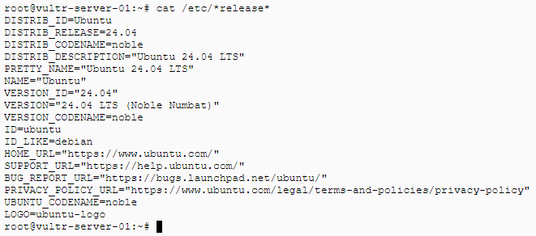
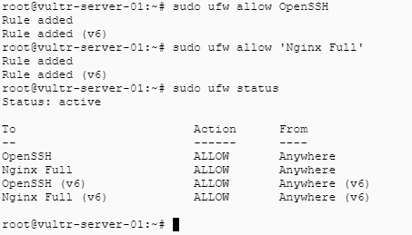

# image-dir

Static image assets referenced from other repositories and documentation.

| File | Preview |
|---|---|
| `release.png` |  |
| `rules.png` |  |

Reference an image with its raw URL:

```markdown

```
